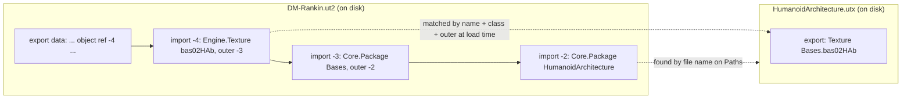
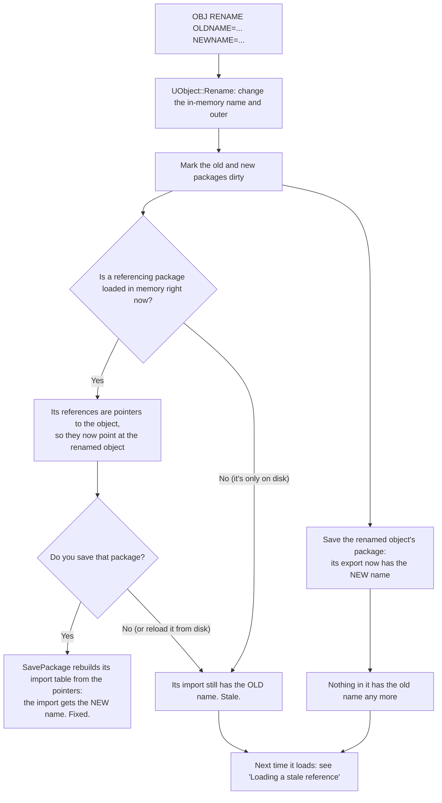
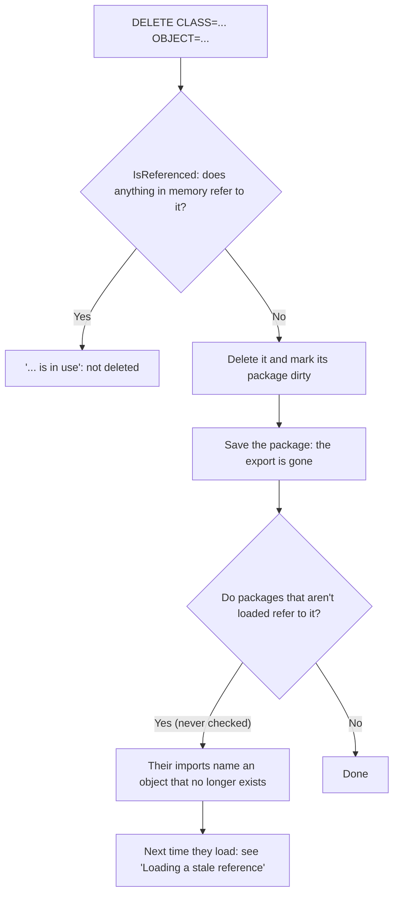
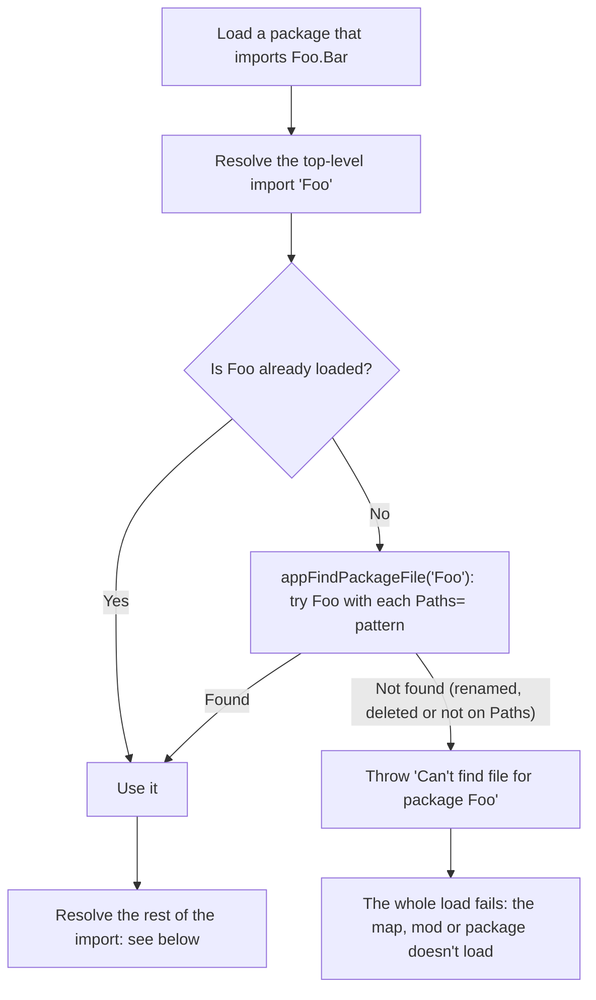
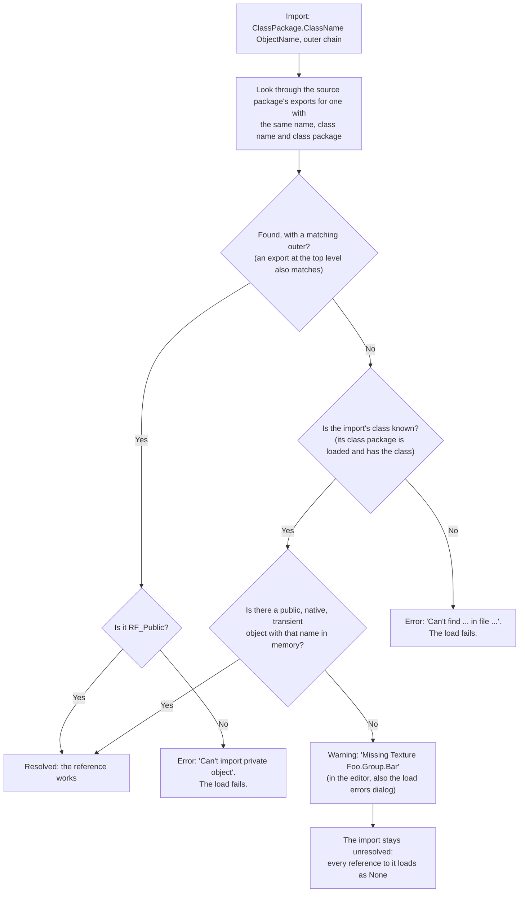
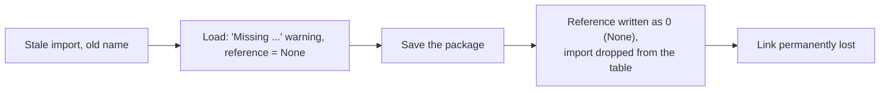
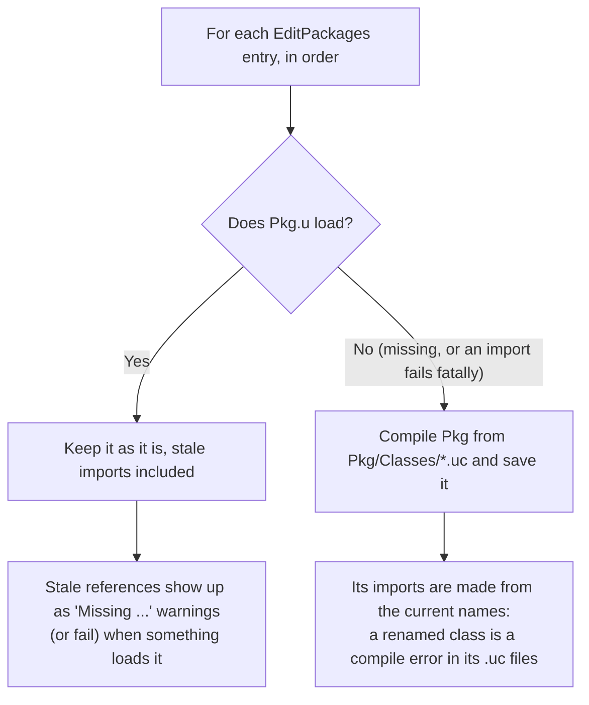

# What happens to references when you rename or delete

This explains why renaming or deleting something in a UE2 package (UT2004
build 3369) doesn't update the packages that refer to it, and what those
packages do the next time they load. It builds on
[`PACKAGE_FORMAT.md`](PACKAGE_FORMAT.md); the references are to the engine
source.

## The short version

A package refers to an object in another package **by name**, not by pointer
or ID. The reference is an import: the class package, the class name, the
object's name and its outer chain (package and groups), all stored as text in
the referencing package. Nothing in the referenced package records who refers
to it, and the engine never searches for referencers on disk.

So a rename or delete only changes the package it happens in, plus any
package that is **loaded in memory at the time and then saved**. Every other
referencing package still has the old name and finds out when it next loads.

There is no arrow from A to B: A doesn't know B exists.

## Renaming an object in the editor

The editor's rename (`OBJ RENAME`, `Editor/Src/UnEdSrv.cpp`) calls
`UObject::Rename` (`Core/Src/UnObj.cpp`), which only changes the in-memory
object's name and outer. It marks the old and new packages dirty and nothing
else.

`SavePackage` doesn't keep imports from the previous file: it builds the
import table each time from the objects the package's data points at
(`FArchiveSaveTagImports`). That's why loading a referencer before renaming
and saving it afterwards fixes it, and why nothing else does.

## Deleting an object in the editor

The editor's delete (`DELETE CLASS=... OBJECT=...`, `UnrealEd/Src/EdHook.cpp`)
refuses if the object is referenced, but it uses `UObject::IsReferenced`,
which only looks at objects **in memory**. Packages on disk are not checked.

## Renaming or deleting a package file

A top-level import (outer 0) is a `Core.Package` import whose name is the
package's **file name**, without the extension. The loader finds the file with
`appFindPackageFile` (`Core/Src/UnMisc.cpp`), trying the name against each
`Paths=` entry in the `[Core.System]` section of the game's `.ini`. Renaming
the file renames the package as far as everyone else is concerned. And unlike
a missing object, a missing package is fatal for whatever is loading.

Renaming a package *inside* the editor (moving objects with `NEWPACKAGE=`)
is an object rename like any other: the objects move to a new package in
memory, and only loaded, re-saved referencers follow them.

## Loading a stale reference

This is `ULinkerLoad::VerifyImport` (`Core/Src/UnLinker.cpp`), which runs for
every import when a package loads. The package file was found; now the loader
looks for the object in it.

The usual result of a rename or delete is the **Missing** path: the object's
class (`Engine.Texture`, `Engine.StaticMesh`, `Core.Class`...) is loaded, so
the loader only warns, and the reference becomes `None`. The package loads
fine, with the texture, mesh or sound gone. One case is worse: if the missing
import is the **class** of one of the package's exports (e.g. a renamed
UnrealScript class whose actors are placed in a map), the loader has no class
to create that export with, and loading typically ends in a serialization
error.

### The None gets saved

If you then save the referencing package, the dead reference is saved as
`None`, and since nothing points at the import any more, the import isn't
written. The old name is gone from the file, so you can't find or fix the
reference afterwards, even by restoring the old name.

## `ucc make`

`ucc make` (`Editor/Src/UMakeCommandlet.cpp`) goes through `EditPackages` in
order and only compiles a package if **loading its `.u` file fails**, which
usually means the file doesn't exist. A dependent package's `.u` that still
loads isn't recompiled, even if a class it uses was renamed or deleted.

So after renaming or deleting a class, delete the `.u` files of every package
that depends on it, not just its own, so they are recompiled against the new
names. (A stale import can fail the load fatally, in which case `ucc make`
rebuilds the package anyway, but the common "Missing" case loads fine and is
skipped.)

## Renaming safely

- **In the editor:** load every package that refers to the object (open the
  maps, load the packages) *before* renaming it, then save all of them along
  with the renamed object's package. Their imports are rebuilt from memory
  with the new name.
- **In script packages:** delete the `.u` of every dependent package and
  rebuild them.
- **Package files:** don't rename one that other packages already import from.
  Every referencer would need to be loaded and re-saved against the new name,
  which the editor can't do because the old file name is how it finds the
  package in the first place.
- **Check afterwards:** load the referencing packages and look for "Missing"
  warnings in the log (or the editor's load errors dialog) *before* saving
  them, because saving turns them into permanent `None`s.
